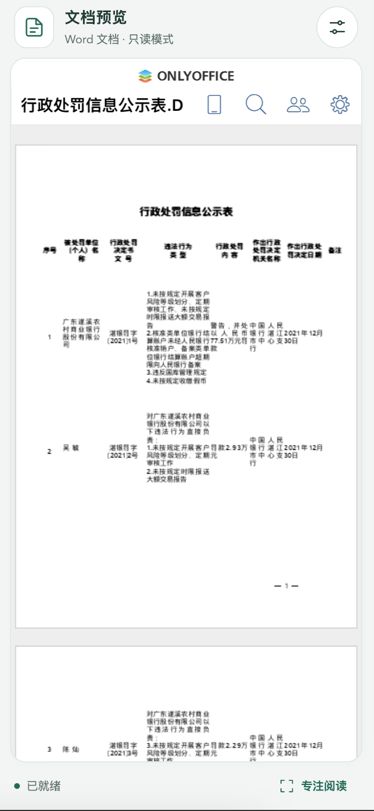
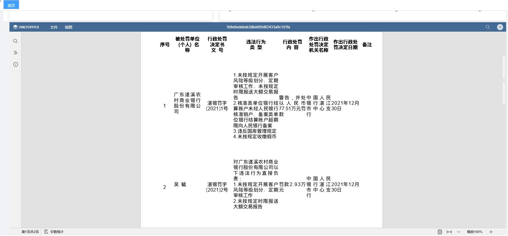

# vue-office-preview

# 介绍
  基于 Vue 2 和 ONLYOFFICE Document Server 的 Office 在线预览组件，支持桌面端和移动端。

## 移动端效果



- 自动适配手机、触屏平板和桌面，支持手动指定 `mobile` / `desktop` 模式。
- 适配横竖屏、动态视口高度和安全区域，提供阅读设置与专注阅读。
- 支持固定分页视图的顶部工具栏，滑动文档时仍可操作（需同源接入，见下方说明）。
- 提供加载状态、错误重试及移动端回归测试。

## 本地开发

```sh
npm ci
npm run dev
```

开发服务监听 `0.0.0.0:3001`。手机与电脑连接同一局域网后，可访问 `http://电脑的局域网IP:3001`，检查触屏操作与横竖屏效果。项目沿用 Webpack 4；Node.js 17+ 如遇 `ERR_OSSL_EVP_UNSUPPORTED`，可使用 `NODE_OPTIONS=--openssl-legacy-provider npm run dev`（构建同理）。

```sh
npm test        # 组件配置、响应式切换和生命周期回归测试
npm run build  # 构建组件
npm run example # 构建示例页
```

示例通过 `/onlyoffice/` 同源代理连接原项目的 ONLYOFFICE 服务（包括 WebSocket）。可在启动开发服务时指定自己的 Document Server：

```sh
ONLYOFFICE_SERVER_URL=https://office.example.com npm run dev
```

业务页面需在挂载组件前加载该服务的 `api.js`。文档 URL 必须能被 Document Server 访问。移动端预览、格式支持及编辑能力取决于所连接的 ONLYOFFICE 版本和授权。可用 `ONLYOFFICE_API_URL` 覆盖示例页的脚本 URL，但固定工具栏需要 iframe 与页面同源。

# 样例




# 开始

```javascript
npm install vue-office-preview --save
```

# 使用
```javascript
import VueOfficePreview from 'vue-office-preview';
Vue.use(VueOfficePreview)
```
# 支持文件格式
|         |  
|  ----   | 
|'doc', 'docm', 'docx', 'dot', 'dotm', 'dotx', 'epub', 'fodt', 'htm', 'html','mht', 'odt', 'ott', 'pdf', 'rtf', 'txt', 'djvu', 'xps'|
|'csv', 'fods', 'ods', 'ots', 'xls', 'xlsm', 'xlsx', 'xlt', 'xltm', 'xltx'| 
|'fodp', 'odp', 'otp', 'pot', 'potm', 'potx', 'pps', 'ppsm', 'ppsx', 'ppt', 'pptm', 'pptx'| 
 


# option参数说明
  |  名称   | 是否必填  | 类型  |默认值| 说明        |
  |  ----   |  ----   | ----  | ----  | ----      |
  | fileType|    是   |  string | '' |  文件类型（扩展名）   |
  | title|    否   |  String | '' |  文件标题  |
  | key|    否   |  String |  '''   |文件索引 |
  | url|    是   |  String | '' |  文件地址；清空后销毁当前预览 |
  | width|    否   |  string | 100%|  视口宽度   |
  | height|    否   |  string | 桌面端 700px，移动端 100dvh | 视口高度；旧浏览器回退至 100vh，显式传值优先 |
  | type|    否   |  string | 'auto' | 'auto' 自动适配，'mobile' 强制移动端，'desktop' 强制桌面端 |
  | lang|    否   |  string | 'zh-CN' |  语言   |
  | isEdit|    否   |  boolean | false | 是否允许编辑 |
  | isPrint|    否   |  boolean | false | 是否允许打印 |
  | model|    否   |  string | isEdit 为 true 时 'edit'，否则 'view' | 沿用原参数名，显式指定 ONLYOFFICE 模式 |
  | token|    否   |  string | 无 | 服务开启 JWT 时，传入后端为当前配置签发的 token |
  | pinToolbar|    否   |  boolean | false | 固定移动端工具栏；需要同源接入，示例已启用 |

## 移动端接入

宿主页面添加 viewport，保留浏览器缩放：

```html
<meta name="viewport" content="width=device-width, initial-scale=1, viewport-fit=cover">
```

默认在视口宽度小于 768px，或设备为无悬停能力的粗指针触屏时启用 ONLYOFFICE 的 `mobile` 界面。手机横屏和触屏平板仍使用移动端界面。模式变化会重建编辑器，单纯高度变化不会重载文档；编辑场景需要保持实例时，可显式设置 `type`。

组件限制在父容器宽度内，移动端默认跟随动态视口高度。如果页面还有标题栏，可使用示例页的 flex 布局，并传入 `height: '100%'` 填满剩余空间（父容器必须有确定高度）；也可以传入 `height: 'calc(100dvh - 64px)'`。

`fileType` 支持大小写。同一页面可放置多个预览实例。组件在开始创建编辑器时触发 `loading`，在文档就绪时触发 `ready`，在 SDK 缺失、文件类型不支持或加载出错时显示提示并触发 `error`，可用“重新加载”重试。

示例页将显示模式放在右上角的“阅读设置”中，底部展示真实加载状态。点击“专注阅读”可收起外层导航，扩大文档区域，再次点击可退出；切换专注状态不会重建编辑器。文档内的工具栏由 ONLYOFFICE 提供。

### 滑动时固定工具栏

ONLYOFFICE 7.3 的分页视图默认在上滑时隐藏工具栏。本组件的 `pinToolbar: true` 在 `onAppReady` 阶段阻止注册 `onMobileScrollDelta` 隐藏回调，保留文档滚动、缩放及其他 SDK 事件；销毁时恢复原方法。该适配已针对 7.3.3 验证，升级 Document Server 后需要重跑移动端回归测试。

该功能需要文档 iframe 与宿主页面同源。跨域或服务不支持时，组件触发 `warning` 事件，保留正常预览。开发代理只在 `npm run dev` 中生效；部署 `example/dist` 或业务页面时也需要配置同源反向代理。例如，在 Nginx 的 `http` 块中定义：

```nginx
map $http_upgrade $office_connection_upgrade {
    default upgrade;
    '' close;
}
```

在业务站点的 `server` 块中添加：

```nginx
location /onlyoffice/ {
    proxy_pass http://114.55.181.13:4009/; # 替换为实际 Document Server
    proxy_http_version 1.1;
    proxy_set_header X-Forwarded-Host $http_host/onlyoffice;
    proxy_set_header X-Forwarded-Proto $scheme;
    proxy_set_header Upgrade $http_upgrade;
    proxy_set_header Connection $office_connection_upgrade;
    proxy_read_timeout 3600s;
}
```

挂载组件前加载 `/onlyoffice/web-apps/apps/api/documents/api.js`。代理仅指向配置的文档服务，HTTP 和 WebSocket 都必须保留转发主机信息，否则文档下载地址可能错误。

可选的浏览器回归测试依赖 Playwright 和 Chromium，需先启动示例服务，再运行 `npm run test:mobile`。测试先关闭固定功能复现上滑隐藏，再启用功能检查上下滑动、横屏、专注阅读和设置操作。可通过 `PLAYWRIGHT_MODULE` 指定已安装的 Playwright 模块路径，`CHROME_EXECUTABLE` 指定本机 Chrome，`PREVIEW_URL` 指定预览地址。

```html
<VueOfficePreview :option="option" @ready="onReady" @error="onError" />
```
 


# 样例

```
    const option = {
        'lang' : 'zh-CN',
        'url' : 'https://qccdata.qichacha.com/CaseSupervisePunish/1b9e6adebab3dbe695d62433a0c1d1fa.DOC',
        'title' : '1b9e6adebab3dbe695d62433a0c1d1fa',
        'fileType' : 'DOC'
    }
   <VueOfficePreview  :option='option' />
  ```
